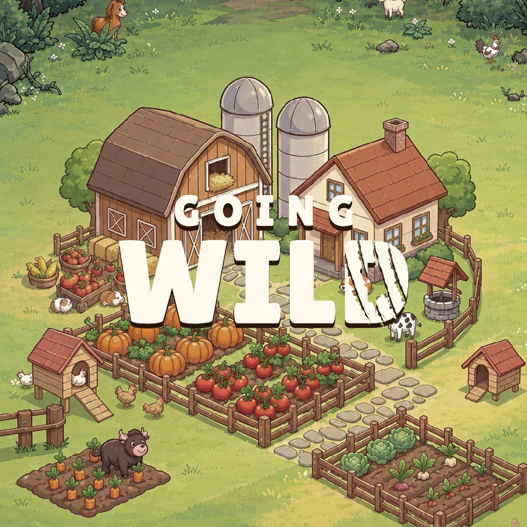
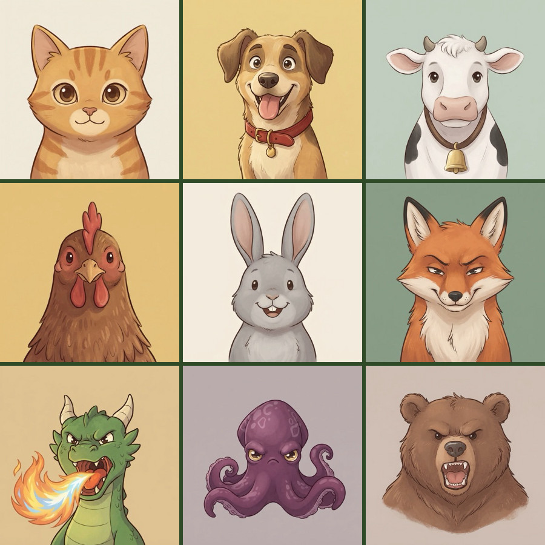
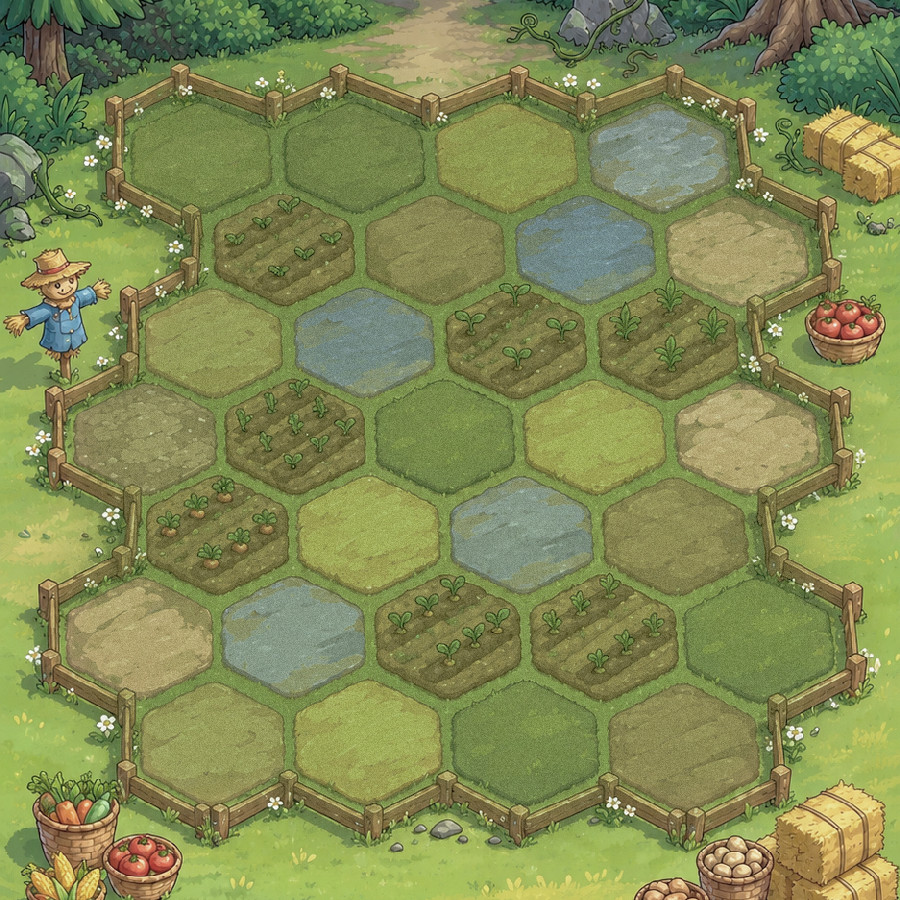

<p align="center">
  
  
  
</p>

# Going Wild

A small farm auto-battler made with Flutter. The farm animals defend the barn from waves of predators.

This project exists to practice Flutter: state management, layered architecture, custom painting, animation and a bit of game rendering with Flame.

## How it plays

- A **phase** has 10 rounds. Each round brings a new wave of predators, and the player has 3 lives.
- **Preparing:** spend coins in the shop, keep animals on the bench and place them on the hexagonal board. Three copies of the same animal merge into a stronger one (more stars). Buying XP raises the level, which allows more animals on the field. Animals share **sets** that give bonuses when enough of them are on the field.
- **Fighting:** the fight plays out by itself. Animals walk hex by hex toward their target, attack when it is in range and cast their ability when their mana is full.
- Winning every round clears the phase and unlocks the next one.

## Architecture

Lightweight layers, all inside `lib/`:

- **`domain/`**: pure Dart, with no Flutter in it. It holds the models (board, characters, combatants, match progress), the rule **engines** (combat, shop, economy, merge, sets…) and the use cases as plain functions. A fight is simulated up front, deterministically, and recorded as a history the UI replays.
- **`content/`**: the actual game data. Each animal lives in its own folder with its stats, ability and sprite (atlas + look and ability effects). This folder also holds the phases, waves and the configured engines.
- **`data/`**: small repositories (current match, progress, settings).
- **`ui/`**: screens, `flutter_bloc` view models and widgets. The field is rendered with **Flame** (`ui/game/unit_stage/`): sprites, walk and attack animations and ability effects, all in sync with the combat replay.
- **`simulation/`**: bots and command-line simulators used to balance the phases.

Stack: Flutter, flutter_bloc, go_router, slang (i18n, pt and en), Flame.

## Running

```bash
flutter run
```

```bash
flutter test
```

The design system catalog, which includes a sprite preview scene, has its own entry point:

```bash
flutter run -t lib/main_design_system_catalog.dart
```
